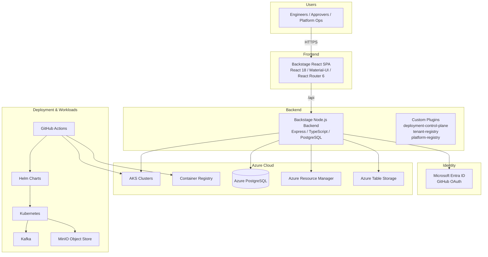

# CloudHub Technology Stack

> Reference: [CloudHub Documentation Home](index.md)

This document describes the complete technology stack used by the **Symphony CloudHub** platform — a Backstage-based internal developer platform (IDP) that orchestrates AKS cluster lifecycle, SRI product deployments, tenant onboarding, and developer workspace provisioning for SymphonyAI.

---

## 1. Overview

CloudHub is built as a modular Backstage monorepo. It combines a React-based frontend, a Node.js/Express backend, Azure-native services, Kubernetes/Helm delivery, and GitHub Actions CI/CD into a single internal platform.



---

## 2. Summary Table

| Category | Technology | Version / Notes | Usage |
|----------|------------|-----------------|-------|
| **Frontend Framework** | [React](https://react.dev/) | 18.x | UI components and SPA runtime |
| **Frontend Router** | [React Router](https://reactrouter.com/) | 6.30.2 | Client-side routing |
| **UI Library** | [Material-UI (MUI)](https://mui.com/) | v4 (`@material-ui/core`) and v9 (`@mui/material`) | Component design system |
| **Frontend Platform** | [Backstage](https://backstage.io/) | 1.49.1 | Developer portal framework |
| **Backend Runtime** | [Node.js](https://nodejs.org/) | 22 or 24 | Server runtime |
| **Backend Framework** | [Express.js](https://expressjs.com/) | 4.x / 5.x | HTTP server and API routes |
| **Language** | [TypeScript](https://www.typescriptlang.org/) | ~5.8.0 | Type-safe source code |
| **Package Manager** | [Yarn](https://yarnpkg.com/) | 4.4.1 with workspaces | Monorepo dependency management |
| **Frontend Build** | Backstage CLI / Webpack | 0.36.0 | Bundle, dev server, lint, test |
| **Backend Build** | Backstage CLI | 0.36.0 | Backend packaging and Docker image builds |
| **Relational Database** | [PostgreSQL](https://www.postgresql.org/) | 16 (local), Azure PostgreSQL (prod) | Backstage catalog, plugins, app data |
| **Dev Database** | [better-sqlite3](https://github.com/WiseLibs/better-sqlite3) | 12.x | Optional lightweight local database |
| **Container Runtime** | [Docker](https://www.docker.com/) | — | Local and production images |
| **Local Orchestration** | [docker-compose](https://docs.docker.com/compose/) | — | Multi-service local stack |
| **Frontend Web Server** | [nginx](https://nginx.org/) | — | Serves static frontend and proxies API calls |
| **Cloud Provider** | [Microsoft Azure](https://azure.microsoft.com/) | — | Compute, identity, networking, storage |
| **Container Registry** | [Azure Container Registry (ACR)](https://azure.microsoft.com/en-us/services/container-registry/) | `symphonyfs.azurecr.io` | Stores CloudHub and workload images |
| **Compute (Platform)** | [Azure App Service](https://azure.microsoft.com/en-us/services/app-service/) | — | Production hosting for frontend + backend |
| **Compute (Workloads)** | [Azure Kubernetes Service (AKS)](https://azure.microsoft.com/en-us/services/kubernetes-service/) | `aks-scp-dev-sdc-st-cms` authorized | Target cluster for SRI product deployments |
| **Identity** | [Microsoft Entra ID](https://www.microsoft.com/en-us/security/business/identity-access/microsoft-entra-id) | — | SSO, group-based authorization |
| **OAuth Provider** | [GitHub OAuth](https://docs.github.com/en/developers/apps/building-oauth-apps) | — | GitHub-based authentication |
| **Azure SDK** | [@azure/identity](https://www.npmjs.com/package/@azure/identity), [@azure/arm-compute](https://www.npmjs.com/package/@azure/arm-compute), [@azure/arm-containerservice](https://www.npmjs.com/package/@azure/arm-containerservice), [@azure/data-tables](https://www.npmjs.com/package/@azure/data-tables) | 4.x, 22.x, 25.x, 13.x | Azure resource management and data access |
| **Kubernetes Client** | [@kubernetes/client-node](https://www.npmjs.com/package/@kubernetes/client-node) | 1.4.0 | AKS API interactions |
| **GitHub API** | [@octokit/rest](https://www.npmjs.com/package/@octokit/rest) | 20.1.1 | Repository, workflow, and PR automation |
| **Orchestration** | [Kubernetes](https://kubernetes.io/) | — | Workload scheduling and management |
| **Package Manager (K8s)** | [Helm](https://helm.sh/) | — | Chart-based Kubernetes deployments |
| **Shared Services** | [Apache Kafka](https://kafka.apache.org/) | Via Helm chart | Streaming platform |
| **Object Storage** | [MinIO](https://min.io/) | Via Helm chart | S3-compatible object store |
| **CI/CD** | [GitHub Actions](https://github.com/features/actions) | — | Build, test, image push, deploy |
| **Unit Testing** | [Jest](https://jestjs.io/) | 30.x | JavaScript/TypeScript unit tests |
| **E2E Testing** | [Playwright](https://playwright.dev/) | 1.32.3 | Browser-based end-to-end tests |
| **Test Utilities** | [@testing-library/react](https://testing-library.com/docs/react-testing-library/intro/), [supertest](https://github.com/ladjs/supertest) | 14.x, 7.x | Component and API testing |
| **Code Quality** | [ESLint](https://eslint.org/) / [Prettier](https://prettier.io/) | — | Lint and formatting |
| **Docs Site** | [MkDocs](https://www.mkdocs.org/) / [Backstage TechDocs](https://backstage.io/docs/features/techdocs/) | — | Documentation generation and rendering |
| **Scaffolding** | [Backstage Scaffolder](https://backstage.io/docs/features/software-templates/) | — | Software templates and self-service workflows |
| **Catalog Sync** | [Microsoft Graph](https://learn.microsoft.com/en-us/graph/) | — | Entra users and groups into Backstage catalog |
| **Serverless Functions** | [Azure Functions](https://azure.microsoft.com/en-us/services/functions/) | Node.js | `aks-scheduler` job |
| **Configuration** | YAML (`app-config*.yaml`, `config/application-*.yml`) | — | Environment-specific configuration |

---

## 3. Architecture Layers

### 3.1 Frontend Layer

| Component | Technology | Purpose |
|-----------|------------|---------|
| SPA Framework | React 18 | Renders the platform UI |
| Routing | React Router 6 | Navigation between pages (`/catalog`, `/deploy`, etc.) |
| Component Library | Material-UI v4 + MUI v9 | Buttons, tables, forms, dialogs |
| Developer Portal | Backstage 1.49.1 | Plugin system, catalog, scaffolder, techdocs, search |
| Custom Plugins | `plugins/*` | Domain-specific UI for deployments, tenants, registry, onboarding |
| Build Tool | Backstage CLI (`backstage-cli package build`) | Production bundle and dev server |
| Container | `docker/Dockerfile.frontend` + nginx | Static asset serving and `/api` proxy |

The frontend is served from an nginx container that proxies `/api/` and `/.backstage/` to the backend via the `BACKEND_ORIGIN` environment variable.

### 3.2 Backend Layer

| Component | Technology | Purpose |
|-----------|------------|---------|
| Runtime | Node.js 22/24 | Server runtime |
| Web Framework | Express 4/5 | REST API routes |
| Platform | Backstage Backend | Plugin wiring, auth, catalog, scaffolder, permissions |
| Database Client | `pg` (node-postgres) | PostgreSQL connectivity |
| Azure SDK | `@azure/identity`, `@azure/arm-*` | Azure compute, AKS, resource graph |
| Kubernetes SDK | `@kubernetes/client-node` | K8s API calls |
| GitHub SDK | `@octokit/rest` | Trigger workflows, read PRs, manage repos |
| Container | `docker/Dockerfile.backend` | Backend production image |

The backend is assembled in [packages/backend](https://github.com/SymphonyAI/platform_cloudhub/tree/main/packages/backend) and loads configuration from `app-config.yaml` plus environment-specific overrides.

### 3.3 Data Layer

| Store | Usage |
|-------|-------|
| PostgreSQL | Primary database for Backstage and custom plugins |
| Azure Table Storage | `COST_AUTOMATION_STORAGE_CONNECTION_STRING` and other plugin state |
| Azure PostgreSQL | Production managed database |
| SQLite (`better-sqlite3`) | Lightweight local/dev alternative |

### 3.4 Identity & Authorization

| Provider | Use Case |
|----------|----------|
| Microsoft Entra ID | SSO and group membership (e.g., `nonprd-cicd-pipeline-trigger-allow`, GPU access groups) |
| GitHub OAuth | Alternative / secondary sign-in provider |
| Backstage Permissions | Permission framework enabled for plugin-level access control |
| Microsoft Graph | Syncs Entra users/groups into the Backstage catalog |

### 3.5 Deployment & Delivery

| Layer | Technology | Purpose |
|-------|------------|---------|
| Source Control | GitHub | Repository hosting |
| CI/CD | GitHub Actions | Quality gates, image builds, App Service and AKS deployments |
| Images | Docker + Azure Container Registry | Frontend and backend images |
| App Hosting | Azure App Service | Production CloudHub frontend and backend |
| Workload Hosting | AKS | SRI product workloads (`common-res`, `detectionhub`, `flows`, `invhub`, etc.) |
| Packaging | Helm | Kubernetes chart releases |
| Shared Platform Services | Kafka, MinIO | Shared streaming and object storage |

### 3.6 Testing & Quality

| Layer | Tool | Purpose |
|-------|------|---------|
| Unit/Integration Tests | Jest | JavaScript and TypeScript tests |
| E2E Tests | Playwright | Browser automation tests |
| Component Tests | React Testing Library | React component behavior |
| API Tests | supertest | Express route validation |
| Lint | ESLint | Static code analysis |
| Format | Prettier | Code formatting |
| Type Check | TypeScript | Compile-time type safety |

---

## 4. Monorepo Structure

```
platform_cloudhub/
├── packages/
│   ├── app/                    # Backstage frontend app
│   └── backend/                # Backstage backend app
├── plugins/                    # Custom domain plugins
│   ├── cluster-registry/
│   ├── customer-onboarding/
│   ├── deployment-control-plane-backend/
│   ├── infrastructure-provisioning/
│   ├── platform-common/
│   ├── platform-deployment/
│   ├── platform-home/
│   ├── platform-registry/
│   ├── platform-registry-backend/
│   ├── tenant-overlay-manager/
│   ├── tenant-registry/
│   └── tenant-registry-backend/
├── charts/                     # Helm umbrella charts
│   ├── common/
│   ├── data/
│   ├── detection/
│   └── investigation/
├── azure-functions/aks-scheduler/  # Azure Functions for scheduling
├── infra/                      # Infrastructure configuration
│   ├── aks/
│   └── workspacemanager/
├── docker/                     # Dockerfiles and nginx template
├── config/                     # Environment datasource profiles
├── docs/                       # TechDocs / MkDocs documentation
└── .github/workflows/          # CI/CD pipelines
```

---

## 5. Configuration Files

| File | Purpose |
|------|---------|
| [app-config.yaml](../app-config.yaml) | Base Backstage configuration |
| [app-config.production.yaml](../app-config.production.yaml) | Production overrides (Azure PostgreSQL, auth, logging) |
| [app-config.github.yaml](../app-config.github.yaml) | GitHub-specific configuration |
| [backstage.json](../backstage.json) | Backstage version metadata |
| [config/application-*.yml](../config/) | JDBC datasource profiles for local/dev/prod |
| [docker-compose.yml](../docker-compose.yml) | Local multi-service stack |
| [tsconfig.json](../tsconfig.json) | TypeScript compiler options |

---

## 6. Key Backstage Plugins Used

### Core Backstage Plugins

| Plugin | Purpose |
|--------|---------|
| `@backstage/plugin-catalog` | Software catalog |
| `@backstage/plugin-catalog-graph` | Entity relationship graph |
| `@backstage/plugin-scaffolder` | Software templates |
| `@backstage/plugin-techdocs` | Documentation rendering |
| `@backstage/plugin-kubernetes` | Kubernetes cluster visibility |
| `@backstage/plugin-api-docs` | API documentation |
| `@backstage/plugin-search` | Global search |
| `@backstage/plugin-notifications` | User notifications |
| `@backstage/plugin-org` | Organization entities |
| `@backstage/plugin-user-settings` | User preferences |
| `@backstage/plugin-github-actions` | GitHub Actions integration |

### Custom Internal Plugins

| Plugin | Layer | Purpose |
|--------|-------|---------|
| `platform-home` | Frontend | Landing page and platform navigation |
| `platform-deployment` | Frontend | Deployment UI and control plane |
| `deployment-control-plane-backend` | Backend | SRI pipeline triggers, AKS/GPU/VM operations |
| `tenant-registry` / `tenant-registry-backend` | Frontend + Backend | Tenant lifecycle management |
| `platform-registry` / `platform-registry-backend` | Frontend + Backend | Platform component registry |
| `cluster-registry` | Frontend | AKS cluster catalog |
| `customer-onboarding` | Frontend | Customer onboarding workflows |
| `infrastructure-provisioning` | Frontend | Infrastructure provisioning requests |
| `tenant-overlay-manager` | Frontend | Customer overlay management |
| `platform-common` | Shared | Shared types and utilities (e.g., SRI deployment catalog) |

---

## 7. CI/CD Workflows

The repository ships several GitHub Actions workflows:

| Workflow | File | Purpose |
|----------|------|---------|
| Quality Gate | `.github/workflows/ci-quality-gate.yml` | Lint, typecheck, test on push/PR |
| Build Images | `.github/workflows/build-fe-be-prod-basic.yml` | Build and push frontend/backend images to ACR |
| Deploy Single Component | `.github/workflows/deploy-component-prod.yml` | Deploy frontend or backend App Service |
| Deploy Both Services | `.github/workflows/deploy-fe-be-prod-basic.yml` | Deploy frontend + backend at an existing tag |
| Release Production | `.github/workflows/release-production.yml` | End-to-end quality → build → deploy |
| Deploy AKS Namespace | `.github/workflows/deploy-aks-namespace.yml` | AKS-targeted deployments |
| Dev Workspace Images | `.github/workflows/dev-workspace-images.yml` | Dev container images |

Images are published to `symphonyfs.azurecr.io/cloudhub-platform/frontend` and `/backend`.

---

## 8. Local Development

The recommended local stack uses Docker Compose:

```bash
./scripts/dev.sh       # Hot reload mode (edit-save-reload, no image rebuild)
./scripts/rebuild.sh   # Build images and start all services
./scripts/restart.sh   # Restart without rebuilding
```

Services:

| Service | Image / Build | Ports | Purpose |
|---------|---------------|-------|---------|
| frontend | `docker/Dockerfile.frontend` | `3000` | Nginx-served React SPA |
| backend | `docker/Dockerfile.backend` | `7007` | Backstage Node.js backend |
| postgres | `postgres:16-alpine` | `5433` | Local PostgreSQL database |

---

## 9. Security & Compliance Notes

- Only the AKS cluster `aks-scp-dev-sdc-st-cms` is authorized for Kubernetes operations in this repository.
- App Service Easy Auth is intentionally disabled; authentication is handled at the Backstage layer.
- GPU Compute and VM power controls are gated by Microsoft Entra ID group membership.
- The canonical `AZURE_*` service principal is used for Azure platform SDKs and CI/CD; Microsoft user sign-in uses separate `AUTH_MICROSOFT_*` settings.
- Permissions framework is enabled for fine-grained plugin access control.

For details, see:

- [copilot-instructions.md](../.github/copilot-instructions.md)
- [LOGIN_ENTRAID.md](LOGIN_ENTRAID.md)
- [github-actions-deployment-workflows.md](github-actions-deployment-workflows.md)

---

## 10. External Resources

- [Backstage Documentation](https://backstage.io/docs)
- [Backstage GitHub](https://github.com/backstage/backstage)
- [React Documentation](https://react.dev/)
- [Microsoft Azure Documentation](https://learn.microsoft.com/en-us/azure/)
- [Helm Documentation](https://helm.sh/docs/)
- [Kubernetes Documentation](https://kubernetes.io/docs/home/)

---

*Last updated: 2026-09-01*
