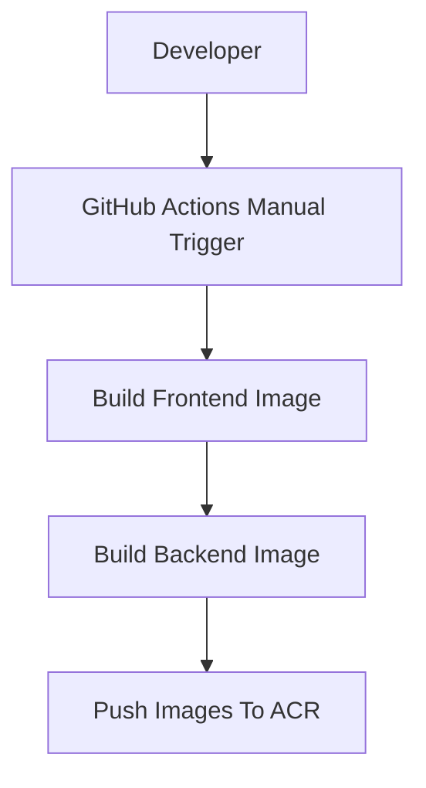

# Container Release Process

## Purpose

This repository publishes frontend and backend container images manually. The release flow is intentionally human-triggered and does not run on `push`, `pull_request`, tag creation, or merge events.

## Release Flow



## Manual Workflow

Use the GitHub Actions workflow named `Build And Push CloudHub Images` and provide:

- `image_tag`
- `push_latest`

Required repository secrets:

- `AZURE_CLIENT_ID`
- `AZURE_TENANT_ID`
- `AZURE_SUBSCRIPTION_ID`
- `AZURE_ACR_USERNAME`
- `AZURE_ACR_PASSWORD`

## Example Release

Input:

```text
image_tag=1.0.0
push_latest=false
```

Produces:

```text
symphonyfs.azurecr.io/cloudhub-platform/frontend:1.0.0

symphonyfs.azurecr.io/cloudhub-platform/backend:1.0.0
```

## Example Release With Latest

Input:

```text
image_tag=1.0.1
push_latest=true
```

Produces:

```text
symphonyfs.azurecr.io/cloudhub-platform/frontend:1.0.1

symphonyfs.azurecr.io/cloudhub-platform/frontend:latest

symphonyfs.azurecr.io/cloudhub-platform/backend:1.0.1

symphonyfs.azurecr.io/cloudhub-platform/backend:latest
```

## Verification Commands

```bash
az acr repository list \
  --name symphonyai \
  --output table
```

```bash
az acr repository show-tags \
  --name symphonyai \
  --repository cloudhub-platform/frontend
```

```bash
az acr repository show-tags \
  --name symphonyai \
  --repository cloudhub-platform/backend
```
