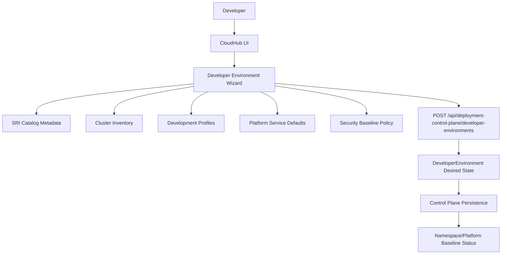
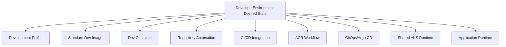

# CloudHub Developer Environment (Phase 1)

## Overview

Phase 1 introduces a first-class **Developer Environment** capability in CloudHub for SRI components. The goal is to provide a standardized, policy-driven self-service workflow where developers request an environment by describing intent, while CloudHub resolves implementation details.

This implementation is integrated into existing CloudHub modules and does not introduce a separate application or new framework.

## Architecture

Developer flow:

Future extension path (Phase 2+):

## Domain Model

### DevelopmentProfile

A versioned platform-managed development standard.

Key fields:

- `id`, `name`, `displayName`, `version`
- `runtime`, `runtimeVersion`, `languages`
- `buildTools`, `platformTools`, `ideConfiguration`
- `deploymentType`, `packaging`
- `observabilityConfiguration`, `securityConfiguration`
- `status` (`ACTIVE`, `DEPRECATED`, `DISABLED`)
- `createdAt`, `updatedAt`

### DeveloperEnvironment

A declarative desired-state resource, not a namespace primitive.

Key fields:

- identity: `id`, `name`, `displayName`, `description`
- application: `productId`, `componentId`, `developmentProfileId`, `developmentProfileVersion`
- source: repository provider/org/name/url, `sourceBranch`
- runtime: `cloudProvider`, `runtimePlatform`, `clusterId`, `clusterName`, `namespace`
- policy: `environmentType`, `resourceProfile`
- platform: `platformServices`, `securityBaseline`
- ownership: `ownerTeam`, `requestedBy`
- lifecycle: `status`, `statusMessage`, `failureReason`, `lastTransitionAt`

### Enums

- Environment type: `SHARED_TEAM`, `DEVELOPER`, `EPHEMERAL_PR` (Phase 1 UI/API supports `SHARED_TEAM` only)
- Status: `DRAFT`, `REQUESTED`, `VALIDATING`, `PROVISIONING`, `READY`, `FAILED`, `DELETING`, `DELETED`
- Resource profile: `SMALL`, `MEDIUM`, `LARGE`

## SRI Catalog Integration

SRI catalog metadata is extended in shared `platform-common` and consumed by backend/frontend:

- Stable machine IDs (`sri-investigation-api`, etc.)
- Language/runtime metadata
- Development profile mapping (`id`, `version`)
- Repository reference (nullable, no invented values)
- Owner team and deployment type

The existing SRI deployment card model remains intact and unchanged for existing SRI deployment workflows.

## Development Profiles Seed

Initial idempotent profile set:

- `node-api`
- `react-ui`
- `python-service`
- `python-ai`
- `python-data`
- `python-agent`
- `java-springboot`
- `scala-spark`
- `postgres-db`

Seed strategy:

- Insert-on-conflict-do-nothing
- Preserves existing admin-managed rows
- Works for both PostgreSQL and in-memory runtime fallback

## Resource Profiles

Configured centrally in backend policy definitions:

- `SMALL`: lightweight workload
- `MEDIUM`: standard API/service workload
- `LARGE`: resource-intensive workload

UI consumes profile definitions, not hard-coded CPU/memory constants in React logic.

## Namespace Strategy (Phase 1)

Shared-team policy:

- Namespace name resolves from owner team (`<team>-dev`), backend-driven.

Behavior:

- If namespace exists in platform-registry inventory for target cluster, status resolves `READY`.
- Otherwise status is modeled as `PENDING`.
- No fake success is shown.

## Platform Services and Security Baseline

Phase 1 models platform services as structured data:

- container registry
- secrets (Key Vault)
- ingress
- observability (logs/metrics/traces)
- optional dependency flags (postgresql/kafka/redis/objectStorage)

Security baseline modeled with explicit state:

- RBAC
- ResourceQuota
- NetworkPolicy
- Pod Security
- Workload Identity
- Key Vault integration
- ACR access
- ingress/DNS
- observability
- governance labels

## API Endpoints

Implemented under `deployment-control-plane` plugin:

- `GET /development-profiles`
- `GET /development-profiles/:id`
- `GET /developer-environments/options`
- `GET /developer-environments`
- `GET /developer-environments/:id`
- `POST /developer-environments`
- `DELETE /developer-environments/:id`

Behavior:

- Backend resolves authoritative component/profile/owner defaults
- Enforces `SHARED_TEAM` for Phase 1 creation
- Performs idempotency by deterministic environment name
- Persists desired state and lifecycle

## Authorization Model

Uses existing persona/group model in control-plane RBAC:

- create: `platform-engineer`, `app-engineering`, `professional-services`
- delete: `platform-engineer`, `app-engineering`
- read: all existing read-enabled personas

Non-platform users are restricted to their own requested environments in API read/delete checks.

## UI Integration

### Sidebar

- New first-class **Developer Environment** nav section
- Positioned before Kubernetes infrastructure/environment registry section

### Routes/Pages

- `/developer-environments` (My Environments landing)
- `/developer-environments/create` (5-step wizard)
- `/developer-environments/:environmentId` (details)

### Wizard Steps

1. Application
2. Source
3. Environment
4. Platform Services
5. Review

Key constraints:

- Development profile is resolved/read-only
- Product fixed to SRI in Phase 1
- Environment type fixed to Shared Team
- Repository can be manually provided only when not configured in catalog

## Persistence

Schema additions are implemented in existing plugin SQL bootstrap pattern (`CREATE TABLE IF NOT EXISTS` + `ALTER TABLE`), consistent with current repository backend plugin conventions.

Tables:

- `control_plane_development_profiles`
- `control_plane_developer_environments`

Indexes:

- component
- owner team
- status
- cluster
- created timestamp

## Observability and Auditability

Creation/deletion actions are audited via existing control-plane audit log mechanisms.
Structured logs are emitted for fallback/lookup behavior and status decisions.

## Phase 1 Limitations

Not implemented in Phase 1:

- Dev container/image generation
- VS Code workspace provisioning
- automatic CI/CD generation
- Argo/GitOps deployment of application workload
- ephemeral PR environments
- per-developer namespace mode
- automatic managed dependency provisioning (PostgreSQL/Kafka/Redis/Object Storage)

These are represented as explicit metadata/state for future phases where applicable.

## Notes for Local Development

If platform-home build fails with `EACCES` under `plugins/platform-home/dist`, fix file ownership/permissions for that directory before rebuilding.

## Phase 2 Reference

Phase 2 implementation details, workspace architecture, image pipeline, and operational guidance are documented in `docs/developer-environment-phase2.md`.
