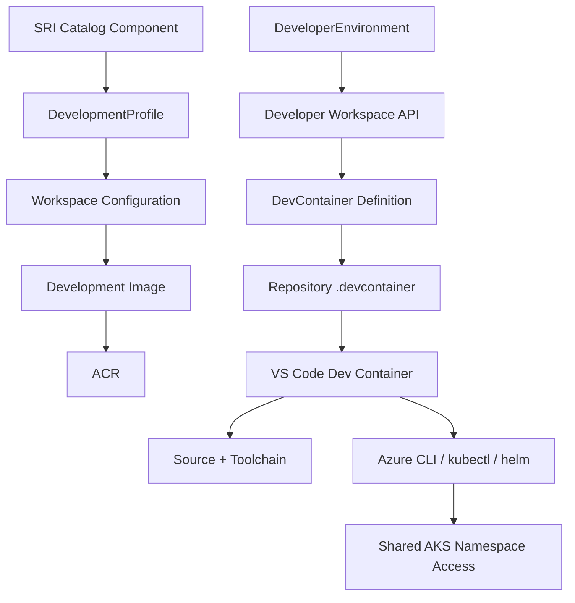

# CloudHub Developer Environment (Phase 2)

## Goal

Phase 2 extends Developer Environment with a standardized Developer Workspace model based on VS Code Dev Containers. The objective is reproducible local development with platform-managed toolchains and strict ownership boundaries.

## Phase 1 Reuse

Phase 2 reuses existing Phase 1 sources of truth:

- SRI component to DevelopmentProfile mapping from platform-common catalog metadata.
- DevelopmentProfile and DeveloperEnvironment persistence in deployment-control-plane backend.
- Existing RBAC model and ownership checks in deployment-control-plane router.
- Existing frontend navigation and Developer Environment details page.

No duplicate domain model or duplicate component-to-profile mapping was introduced in frontend code.

## Architecture

## Ownership Boundary

Platform Engineering owns:

- development images and toolchains
- image CI build, smoke tests, and scanning
- development profile workspace configuration

Application teams own:

- source code and dependency manifests
- application runtime image and deployment behavior
- repository-specific run/debug settings

## Workspace Status Model

Workspace state is tracked independently from environment lifecycle.

Workspace states:

- NOT_CONFIGURED
- CONFIGURING
- READY
- OUTDATED
- INVALID
- CUSTOM
- FAILED

Dev Container states:

- NOT_CONFIGURED
- PLATFORM_MANAGED
- CUSTOM
- OUTDATED
- INVALID
- CONFLICT

## Development Image Model

Logical image hierarchy:

- cloudhub/dev/base:1.0.0
- cloudhub/dev/node:1.0.0
- cloudhub/dev/python:1.0.0
- cloudhub/dev/java:1.0.0
- cloudhub/dev/scala:1.0.0
- cloudhub/dev/postgres:1.0.0

Images are defined in developer-environments/images and built via workflow automation.

## Runtime Evidence Found in Current Workspace

Observed in this repository:

- Node 22 in CI workflows and root engines node 22 || 24.
- Node >=20 in Azure Function package engines.
- Python 3.11 in integrations workflow configuration.

Not observed in this repository (external SRI repos were not accessible from this workspace):

- authoritative Java runtime/build version per SRI repo
- authoritative Scala/Spark toolchain versions per SRI repo

These remain explicit follow-up validation items before production profile promotion.

## Workspace API

Added endpoints:

- GET /api/deployment-control-plane/developer-environments/:id/workspace
- POST /api/deployment-control-plane/developer-environments/:id/workspace/validate
- POST /api/deployment-control-plane/developer-environments/:id/workspace/generate

Security:

- same environment ownership checks as existing details/read APIs
- no credentials returned in API responses

## Repository Integration

Implemented:

- read-only Dev Container inspection using GitHub contents API when token is configured
- deterministic generation of expected .devcontainer/devcontainer.json

Not implemented:

- branch commit and pull request creation for Dev Container updates

Reason:

- existing backend integration does not currently expose a safe, approved PR lifecycle for application repositories in this path
- Phase 2 returns generated files and manual PR instructions instead of faking PR automation

## Dev Container Standard

Generated Dev Container definition is intentionally thin:

- uses centrally managed platform image
- sets remoteUser to non-root developer
- includes approved profile extensions/settings
- does not embed credentials or tokens

## AKS / Auth Boundaries

- No kubeconfig is baked into images.
- No Azure or GitHub credentials are baked into images.
- Cluster access is expected via runtime identity authentication and existing enterprise RBAC.

## CI Pipeline for Development Images

Workflow file:

- .github/workflows/dev-workspace-images.yml

Pipeline includes:

- docker build for each image family
- smoke test execution per image
- Trivy vulnerability scan gate
- publish stage to ACR on non-PR events

## Smoke Tests

Script:

- developer-environments/tests/images/smoke-test.sh

Verifies:

- base tools (git, kubectl, helm, az, gh, developer user)
- language/toolchain binaries by image family

## Known Limitations

- No automatic PR creation for Dev Container updates yet.
- Java/Scala version defaults require final validation against external SRI source repositories before production promotion.
- Workspace readiness can be read/validated/generated, but repository mutation remains manual.

## Upgrade Path

Recommended controlled upgrade model:

- profile version increments (v1, v2)
- image tag updates per profile
- workspace validation detects OUTDATED and surfaces update availability
- no forced automatic repository change

## Troubleshooting

If workspace validation reports NOT_CONFIGURED:

1. Generate expected Dev Container from CloudHub.
2. Add .devcontainer/devcontainer.json on a feature branch.
3. Create and merge a pull request.
4. Re-run workspace validation.

If workspace validation reports FAILED:

1. Verify backend GitHub token/runtime configuration.
2. Verify repository metadata in Developer Environment.
3. Re-run validation and inspect backend logs.
